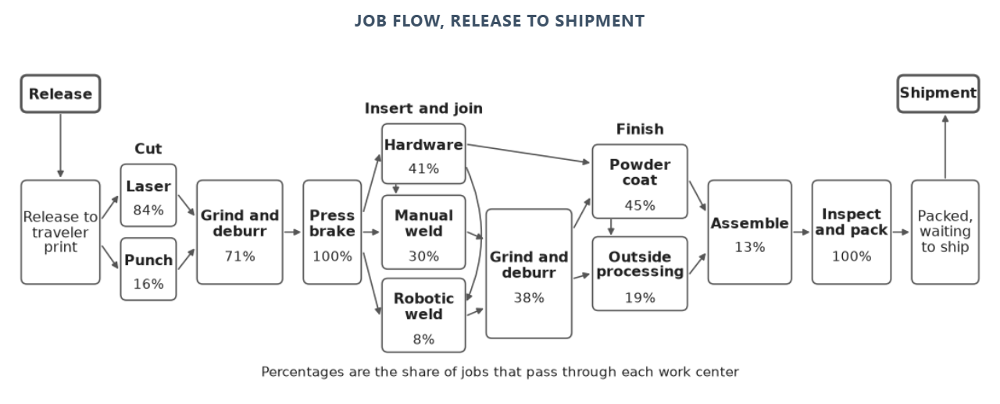
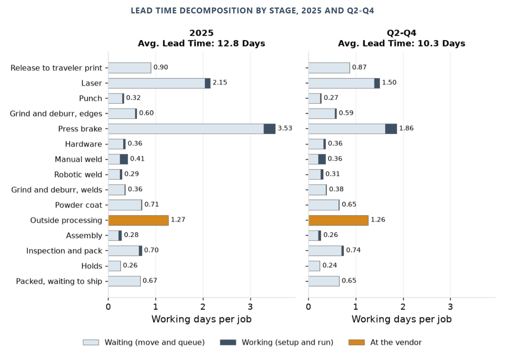
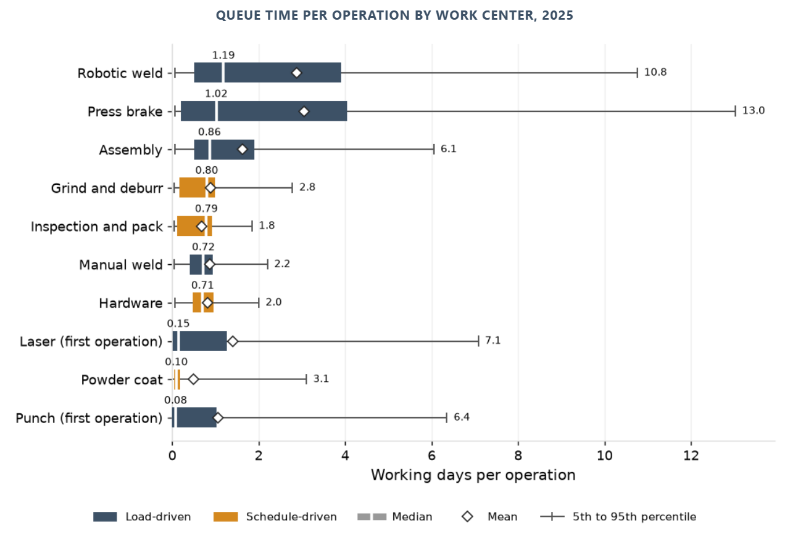
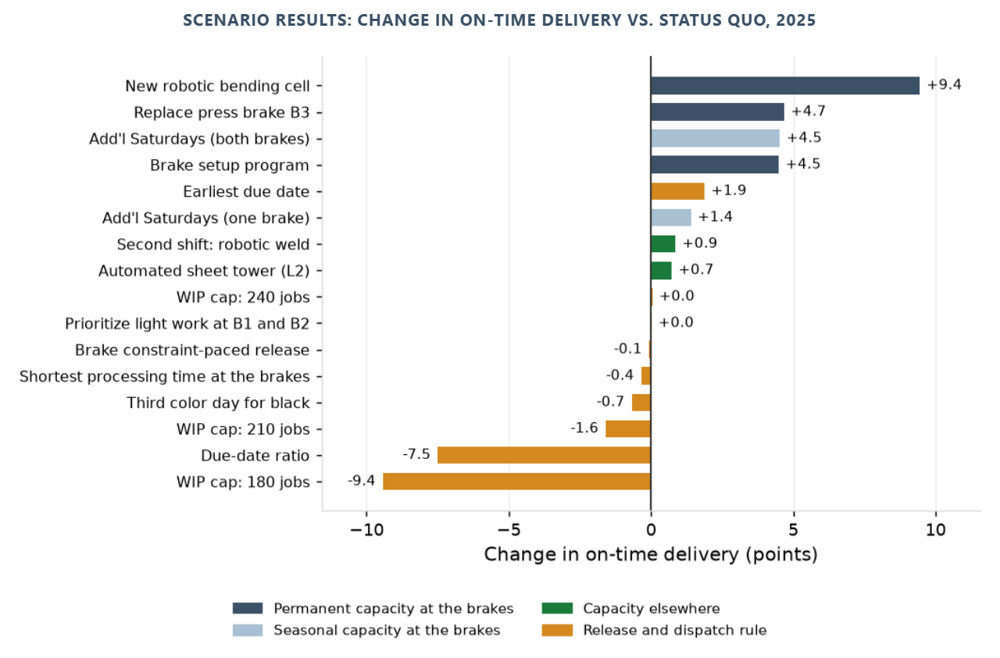
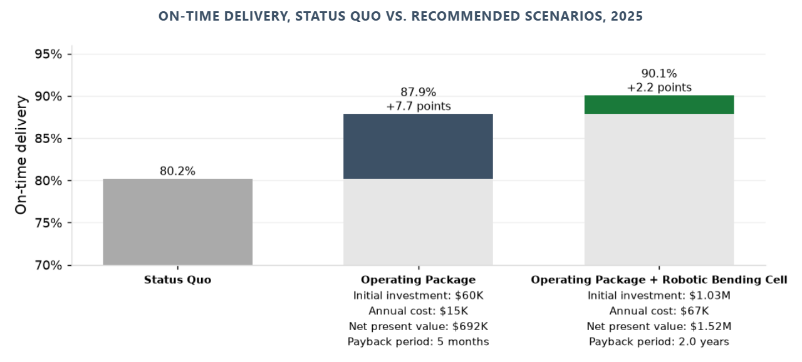

# mfg-operations-analytics

Three client reports on a custom sheet-metal fabrication job shop, built on its complete ERP and MES record for January 2023 to December 2025. Flow and On-time Delivery traces where lead time goes between release and shipment, attributes each late job's lost days to the stage that lost them, and measures how accurately the shop's quote predicts lead time. Capacity, Constraints and Setups identifies the press brakes as the shop's constraint and measures what setups over standard cost them. Discrete Event Simulation: On-time Delivery replays the shop's jobs on a validated model of the floor, tests 16 release, dispatch and capacity changes, and sets the cost, NPV and payback of those that work against their gain in on-time delivery.

- A data pipeline from raw system exports to analysis-ready marts: DuckDB, dbt with schema tests, one build command that regenerates every table, figure and page byte-identically.











## Business context

The shop is a custom sheet-metal fabricator: about 120 employees, ISO 9001, one plant, about 2,000 active part numbers, 450 customers, about 5,200 jobs a year in lots from 1 to 500 pieces. Laser cutting, CNC punching, press brake forming, hardware insertion, welding, powder coating and light assembly in house; plating, anodizing and heat treat at outside vendors. Two shifts on the lasers and brakes, one elsewhere, Saturdays when behind.

The shop quotes a fixed lead time by routing class, measures on-time delivery weekly, and records a late reason on each late job. In 2025 it delivered 80.8% on time. The late-reason codes did not explain the misses: a large share (36%) of late reasons were blank, and the coded ones pointed at the operation where the job was found late rather than where it lost the time. A first-quarter decline that year was felt on the floor as a brake-capacity problem, and the shop was weighing three capital options: replacing a press brake with an automatic tool-changing model, an automated sheet tower on a laser, and a robotic bending cell.

The engagement put the ERP order and quote records beside the MES operation timestamps for three years, every job and every operation, to answer what the reports could not: where lead time goes, which stage each late job lost its days at, which work center sets the lead time and what variability at it costs, what lead time the shop should quote at its current load, and which of the capital options pays back on measured hours. The three reports below are the result.

## Reports

| Report | Question | Finding | Deliverable |
|---|---|---|---|
| Flow and On-time Delivery | Where does lead time go, why are jobs late, and how accurate is the quoted lead time? | Queue at the press brakes is 24% of lead time and where late jobs lose the most time (5.76 days against 2.50 for on-time jobs). Waiting at work centers caused 42% of the 3,473 days lost in 2025 and late release 21%, and 36% of late jobs carry no reason code. The quote misses actual lead time by 4.8 days on average: too long in ordinary months, too short in the year-end build. | [report](https://brimsystems.github.io/mfg-operations-analytics/docs/reports/lead_time_and_late_jobs.html) |
| Capacity, Constraints and Setups | Which work center sets lead time, and what do brake setups cost? | The press brakes are the constraint: 91% utilized against 97% uptime, a buffer of 6 points, and 53% of queue time. Brake setups ran 1,847 hours over standard in 2025, 36 hours a week or 10.4 points of brake utilization. | [report](https://brimsystems.github.io/mfg-operations-analytics/docs/reports/capacity_constraints_and_setups.html) |
| Discrete Event Simulation: On-time Delivery | Which changes raise on-time delivery, and what do they cost and return? | Only changes that add brake capacity move on-time delivery materially; release and dispatch rules add at most 1.9 points. The operating package, a brake setup program plus planned Saturdays on both brakes, raises 2025 on-time delivery 7.7 points to 87.9% for $60,000 once, with a 0.4-year payback. A robotic bending cell adds 2.2 points on top, with an NPV of $1.52M and a 2.0-year payback. The model reproduces all ten validation measures within tolerance. | [report](https://brimsystems.github.io/mfg-operations-analytics/docs/reports/options_tested.html) |

Index of deliverables: [docs/index.html](https://brimsystems.github.io/mfg-operations-analytics/docs/index.html).

## Methods

Lead-time decomposition by stage and Little's Law; late-job attribution of lost days by stage against the stage's own normal, checked against the shop's reason codes; utilization and queue-time curves by work center; setup against standard by lot size and work center; quote accuracy by condition at release, with a candidate quote evaluated out of sample; a discrete event model of the floor validated against ten measures set before it was run, testing 16 changes and combinations over 30 runs each with 95% intervals; NPV, payback and break-even on stated assumptions.

Data engineering: raw system exports loaded to DuckDB; a dbt project with schema tests on every mart; one build command that regenerates every table, figure and page byte-identically from the committed inputs; fixed input ordering and per-scenario seeding so that the floor model reproduces to the digit.

## Data

The record carries what these systems carry in practice: blank and miscoded late reasons, operations closed in batches at the end of a shift, standards not updated after routing changes, and a 2024 year-end build that shows in every queue. The analyses work with the record as it stands and say so where it limits a finding.

| System | Export | Tables | Grain | Batch |
|---|---|---|---|---|
| ERP | data/raw/erp/ (16 CSV files) | customers, export_batch, inventory_items, inventory_transactions, job_operations, jobs, order_lines, parts, po_lines, purchase_orders, quote_lines, quotes, routings, sales_orders, shipments, work_center_calendar | customer, part, routing operation, quote, quote line, sales order, order line, job, job operation, inventory item, inventory transaction, purchase order, PO line, shipment, work center and day, export batch | 20261012T153907Z-20250101 |
| Shop-floor data collection | data/raw/mes/ (6 CSV files) | holds, job_status_events, kit_checks, labor_transactions, laser_nests, powder_color_schedule | labor transaction, job status event, hold, kit check, laser nest, powder color and day | 20261012T153907Z-20250101 |
| QMS | data/raw/qms/ (2 CSV files) | ncrs, rework_ops | nonconformance, rework operation | 20261012T153907Z-20250101 |
| Maintenance | data/raw/maintenance/ (1 CSV file) | downtime_events | downtime event | 20261012T153907Z-20250101 |
| HR | data/raw/hr/ (2 CSV files) | attendance, employees | employee, employee and day | 20261012T153907Z-20250101 |

`pipeline/load` loads the CSV exports under `data/raw` into DuckDB with dlt, one text table per file. The dbt project under `pipeline/dbt` builds the staging models (one per export, typed), the intermediate models (working-day clock, machine time, queue, lead time by stage, WIP, utilization, setups, late-job attribution) and the marts, with tests on keys. The scripts under `analytics/` read the marts and write the three reports and their figures under `docs/`, and this file. The shop model under `analytics/release_control/` replays the released jobs for the scenarios of the simulation report; its runs are saved under `results/` and each run repeats exactly from its scenario and replication number.

## How to run

Python 3.12 or later, from a clean clone:

```
python -m venv .venv
.venv\Scripts\activate            # Windows; on Linux or macOS: source .venv/bin/activate
pip install -e .
python -m pipeline.load.load_exports
cd pipeline/dbt
dbt build --profiles-dir .
cd ../..
python -m analytics.build_all
```

`analytics.build_all` uses the saved model runs. To repeat the runs (several hours on six processes):

```
python -m analytics.release_control.scenarios 30 6
python -m analytics.technology_roi.scenarios 30 6
python -m analytics.technology_roi.scenarios 30 6 laser_queue
```

## Author

Brian Davis. Data engineering and applied analytics/ML for manufacturers. Other work: [github.com/brimsystems](https://github.com/brimsystems?tab=repositories).
